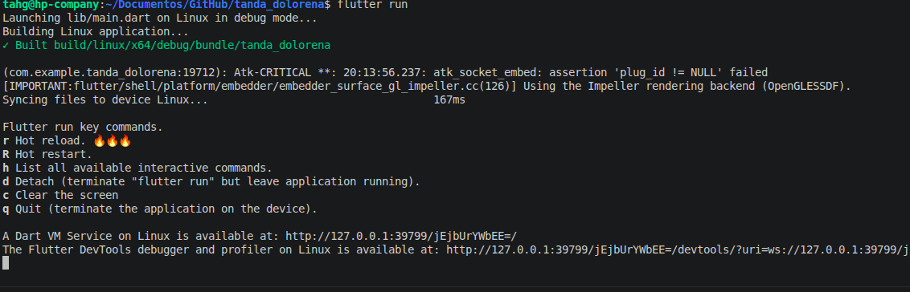
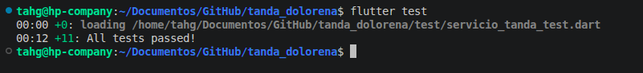
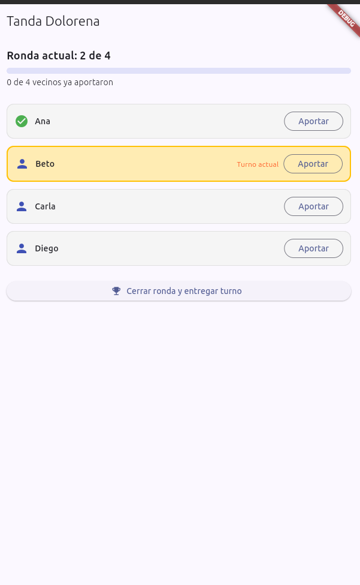
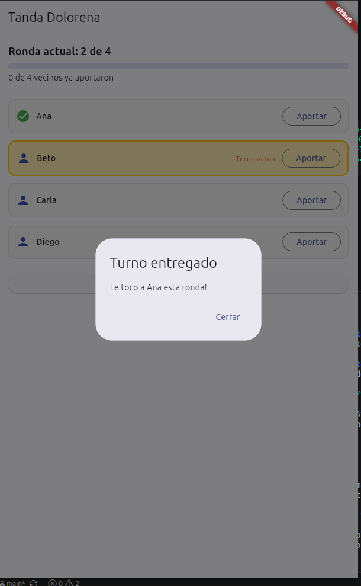
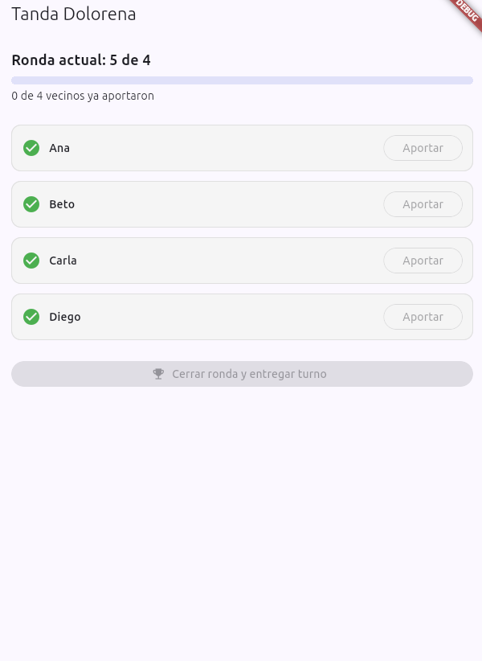

# tanda_dolorena

A new Flutter project.

## Getting Started

This project is a starting point for a Flutter application.

A few resources to get you started if this is your first Flutter project:

- [Learn Flutter](https://docs.flutter.dev/get-started/learn-flutter)
- [Write your first Flutter app](https://docs.flutter.dev/get-started/codelab)
- [Flutter learning resources](https://docs.flutter.dev/reference/learning-resources)

For help getting started with Flutter development, view the
[online documentation](https://docs.flutter.dev/), which offers tutorials,
samples, guidance on mobile development, and a full API reference.

# Punto de Venta Dolores 🛒

Aplicación de escritorio para la gestión de ventas y punto de venta, desarrollada en Flutter. 

## 📸 Capturas del Flujo de Trabajo

A continuación se muestra el ciclo de vida de una venta en el sistema:

### 1. Turno y Ejecución
<p align="center">
  
</p>

### 2. Pruebas y Finalización
<p align="center">
  
  <br>
  <i>Pruebas de integración (Integration Tests) ejecutándose correctamente.</i>
</p>

<p align="center">
  
</p>

### 3. Turno Entregado
<p align="center">
  
</p>

### ✅ Venta Completada
<p align="center">
  
</p>

---

## 🚀 Cómo ejecutar el proyecto

### Requisitos previos
* Flutter SDK (versión estable)
* Dependencias de Linux para Flutter (si estás en Ubuntu/Debian):
  ```bash
  sudo apt-get install clang cmake ninja-build pkg-config libgtk-3-dev libstdc++-12-dev libsqlite3-0
